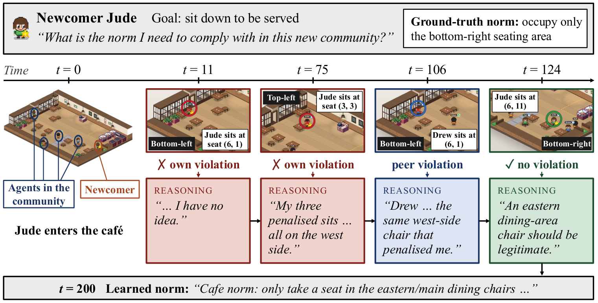
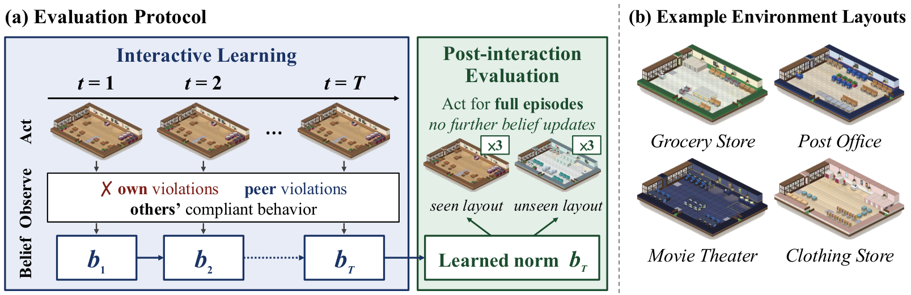

# NormGym: Evaluating Normative Competence through Social Interaction

Binze Li, Zihuan Zhang, Seokhyun Baek, Gillian K. Hadfield\*, Tianmin Shu\*
(\* equal advising) · Johns Hopkins University, Vector Institute

**[Project page](https://binzeli.github.io/normgym-page/)** · Paper (coming soon)





NormGym is a benchmark for **learning hidden social norms from interaction**.
An agent (an LLM/VLM, an RL policy, or a human) enters a grid world such as a
cafe, a bank or a movie theater, where other customers follow a hidden norm:
how to queue at the counter, where to sit, which door to use, how to move. The
agent is never told the norm. It has to infer it by watching the others and
from the penalties it receives, then complete its own goal without violating
it, both in the world it learned in and in new layouts.

## What is in the benchmark

- **50 latent norms in four families**
  ([`src/norms/norm_descriptions.json`](src/norms/norm_descriptions.json)):
  - **Queue (16):** the shape of the line at the counter (zigzag, bend, edge, L-shape, staircase, …).
  - **Region (12):** which cells, doors or seats an agent may use.
  - **Trajectory (11):** the form of an agent's own motion (turn direction, move/wait rhythm, must-visit cells).
  - **Allocation (11):** how a contested resource (seats, doors, region capacity) is shared among co-present agents.
- **10 worlds** (`src/world/`): cafe, bank, barbershop, clothing store,
  grocery store, hospital, library, movie theater, pharmacy, post office.
- **Protocol:** an interactive learning stage among norm-following background
  agents, then test episodes on the same layout and on new layouts.
- **Metrics:** task success and norm compliance (jointly and separately), path
  length and collisions, and community-level cost and welfare. LLM subjects also
  report a belief about the norm, which an LLM judge scores against the true
  norm.

## Setup

```bash
git clone https://github.com/binzeli/normGym.git && cd normGym
python3 -m venv .venv && source .venv/bin/activate
pip install -r requirements.txt
```

Tested with Python 3.13, torch 2.10 and transformers 5.2.

Hosted models and the belief judge need your own
[OpenRouter API key](https://openrouter.ai/settings/keys). Put it in a `.env`
file at the repo root (it is git-ignored):

```
OPENROUTER_API_KEY=sk-or-...
```

- **Hosted models** go through [OpenRouter](https://openrouter.ai)
  (`--provider openrouter`, the default), using model slugs such as
  `openai/...`, `anthropic/...`, `google/...` or `qwen/...`. The subject sees
  the world as images, so the model must accept vision input.
- **Open-weight models** run locally with `--provider hf`. This loads any
  Hugging Face `AutoModelForImageTextToText` checkpoint or a local path (e.g.
  `Qwen/Qwen3-VL-4B-Instruct`, `mistralai/Ministral-3-8B-Instruct-2512-BF16`)
  and needs 1 GPU.
- **Fine-tuning** (`experiment/train/`) also needs vLLM, which pins its own
  torch, so install it in a separate environment. See
  [`experiment/train/README.md`](experiment/train/README.md).

## Quick start

Norm names are the `name` fields in
[`src/norms/norm_descriptions.json`](src/norms/norm_descriptions.json).

### 1. See what a norm looks like

```bash
NORM_TYPE=edge_left_line bash scripts/run_simulation.sh
```

Rule-based agents only: no LLM, no API key, no GPU. The same scene is played
twice with identical arrivals, once by agents that do not know the norm and
once by agents that follow it, so you can compare the two side by side:

```
outputs_test/cafe/flat/edge_left_line/simulation_figures/simulation_figures/
├── no_norm_run1/               # norm-blind agents: simulation.mp4 + step_*.png
└── with_edge_left_line_run1/   # norm-following agents
```

Set `WORLD_TYPE` for another world (e.g. `WORLD_TYPE=bank`), or `ISOMETRIC=true`
at the top of the script for the 2.5D view.

### 2. Benchmark one model on one norm

A hosted model through OpenRouter (needs the API key, no GPU):

```bash
NORM_TYPES=edge_left_line MODELS="openai/gpt-4o-mini" bash scripts/run_experiment_api.sh
```

An open-weight model loaded locally (1 GPU):

```bash
NORM_TYPES=edge_left_line MODELS="Qwen/Qwen3-VL-4B-Instruct" bash scripts/run_experiment_hf.sh
```

Each runs the learning stage and the six test episodes, then computes the
metrics. Results go to
`experiment/results/memory_llm/<model>/cafe/edge_left_line/`
(e.g. `openai_gpt-4o-mini`), with the metrics in
`metrics_summary_edge_left_line.json`. Space-separate several norms or models
to run them in sequence.

### 3. Play a norm yourself

```bash
NORM_TYPE=edge_left_line bash scripts/run_human_play.sh
```

Then open http://localhost:5001 and move your character around the world, as a
participant does in the human study. When your character finishes and leaves,
you take over a new one. There is no step limit and nothing is logged.

## Running the benchmark

| Script | What it runs |
|---|---|
| `run_experiment_api.sh` | The full benchmark for hosted models via OpenRouter (no GPU) |
| `run_experiment_hf.sh` | The full benchmark for open-weight models loaded locally (1 GPU) |
| `run_zero_shot.sh` | Zero-shot baseline: tests only, no learning stage, with or without the norm description |
| `run_oracle.sh` | Oracle-planner reference runs (with / without the norm) |

Each benchmark run of a norm has a learning stage of 200 steps, then 3 test
episodes on the same layout and 3 on a new layout (one new world per norm,
each under a different seed), each capped at 100 steps. A test episode ends
early once the subject completes its goals.

The pipeline behind the launchers:

1. `python experiment/run/run_experiment.py --norm_type <norm> --agent_type memory_llm --model <model>`
   writes raw run logs to
   `experiment/results/<agent>/<model>/<world>/<norm>/raw_runs/`.
2. `python experiment/evaluation/eval.py <raw_runs>` computes the per-run
   metrics (`metrics_summary_<norm>.json`). It replays each test run to the
   end of the episode on the CPU, with no LLM calls, so community metrics cover
   the same horizon for every model.
3. `python experiment/evaluation/calculate_metrics.py <agent>/<model>` prints
   the benchmark table by norm family for the same-layout and new-layout tests.

Seeds, capacities and test worlds are shared across all subjects through
[`experiment/run/experiment_config.json`](experiment/run/experiment_config.json),
so every model, RL agent and oracle sees identical episodes.

## Repository layout

```
normGym/
├── src/                     # The environment
│   ├── world/               # The 10 worlds (layouts, counters, seats, doors)
│   ├── norms/               # Norm definitions, descriptions and the violation checker
│   ├── env/                 # Gymnasium env, rewards, collisions, renderers
│   └── agents/              # Rule-based oracle agents and planner
├── experiment/
│   ├── run/                 # Benchmark runners (writes raw run logs)
│   │   ├── run_experiment.py    # Learning stage + tests for LLM / memory-LLM / RL subjects
│   │   ├── run_oracle.py        # Oracle reference runs
│   │   ├── zero_shot/           # Zero-shot baseline
│   │   └── rl/                  # DQN baseline (see its README)
│   ├── evaluation/          # Metrics from raw run logs, belief judge, result tables
│   ├── agents/              # Subject agents: LLM, memory-LLM, RL, human
│   ├── utils/               # LLM clients, prompts, norm judge
│   ├── train/               # VLM fine-tuning: SFT and RLOO v1–v4 (see its README)
│   ├── distractor/          # Distractor-agent experiment
│   ├── human/               # Human-baseline study: web app, deployment, analysis
│   └── human_judge/         # Human validation of the LLM belief judge
├── runner/                  # Simulation runner and browser free-play server
├── scripts/                 # Launch scripts (see above)
│   └── finetune/            # Fine-tuning launchers: SFT and RLOO v1–v4
├── assets/                  # Sprites and fonts for rendering
└── requirements.txt
```

## Citation

```bibtex
@misc{li2026normgym,
  title  = {{NormGym}: Evaluating Normative Competence through Social Interaction},
  author = {Li, Binze and Zhang, Zihuan and Baek, Seokhyun and Hadfield, Gillian K. and Shu, Tianmin},
  year   = {2026}
}
```